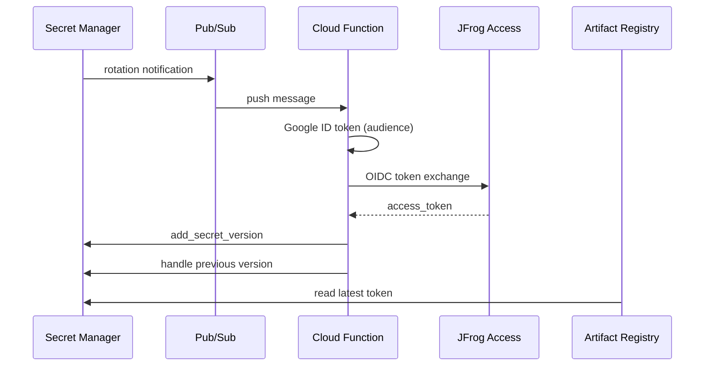

# JFrog GCP Secret Rotator

## Use case

Maintain a JFrog access token in Google Secret Manager with regular updates, eliminating the need to store persistent JFrog passwords or tokens in the rotation function—rotation is securely controlled using Google identity and JFrog OIDC settings.

## Solution

**Cloud Functions (2nd gen)** rotates a Secret Manager secret on schedule. Gen2 functions are implemented as Cloud Run services under the hood. When Secret Manager emits a rotation event, the function obtains a Google OIDC ID token, exchanges it for a JFrog access token via JFrog's OIDC token endpoint, and stores the new access token as a new secret version.

The function source code is in [`secret-rotator/`](secret-rotator/) (`main.py`, `requirements.txt`).

## Architecture

1. **Secret Manager** hits the configured rotation schedule and publishes an event notification.
2. **Pub/Sub** receives the notification on your topic.
3. **Cloud Functions (2nd gen)** runs `rotate_secret_handler` for that message.
4. The function:
   - Ignores non-rotation events (only processes `SECRET_ROTATE`).
   - Fetches a Google ID token for the configured **audience** via `google.oauth2.id_token.fetch_id_token(request, audience)`.
   - Calls JFrog `POST https://<JFROG_HOST>/access/api/v1/oidc/token` (RFC 8693-style token exchange).
   - Adds a **new secret version** with the returned `access_token`.
   - Optionally **DESTROY**, **DISABLE**, or **KEEP** the previous version (see `PREV_SECRET_ACTION`).
5. **JFrog token exchange** uses OIDC identity mappings to exchange the GCP token for a JFrog access token.
6. **Artifact Registry** reads the rotated token from Secret Manager (GAR Connector mode remote repositories).

## Setup

Choose one deployment path:

- **[Manual setup (gcloud & REST API)](docs/manual-setup.md)** — step-by-step `gcloud` commands and JFrog OIDC configuration via curl
- **[Terraform setup](docs/terraform-setup.md)** — Infrastructure-as-Code via [`terraform-example/`](terraform-example/); optionally creates JFrog OIDC provider and identity mapping (`create_jfrog_oidc`, default `true`)

Both paths provision the rotation pipeline and grant the Artifact Registry service agent read access to the secret so GAR Connector mode repositories can use the rotated token.
