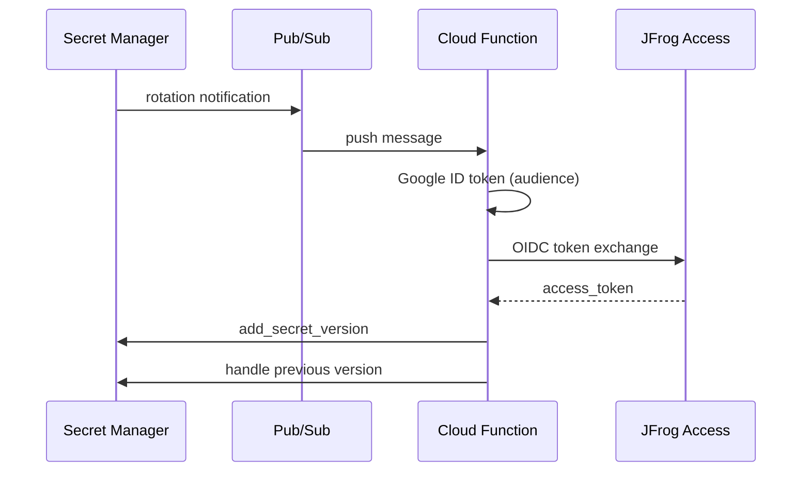

# JFrog GCP Secret Rotator

# Use case: 
Keep a JFrog access token in Secret Manager fresh without storing long-lived Artifactory passwords in the rotator—rotation is driven by Google identity and JFrog OIDC configuration.

# Solution
**Google Cloud Function (2nd gen)** that rotates a Secret Manager secret on schedule. When Secret Manager emits a rotation event, the function obtains a Google OIDC ID token, exchanges it for a JFrog access token via JFrog’s OIDC token endpoint, and stores the new access token as a new secret version.


## High-Level process and components

1. **Secret Manager** hits the configured rotation schedule and publishes an event notification.
2. **Pub/Sub** receives the notification on your topic.
3. **Cloud Functions** runs `rotate_secret_handler` for that message.
4. The function:
   - Ignores non-rotation events (only processes `SECRET_ROTATE`).
   - Fetches a Google ID token for the configured **audience**.
   - Calls JFrog `POST https://<JFROG_HOST>/access/api/v1/oidc/token` (RFC 8693-style token exchange).
   - Adds a **new secret version** with the returned `access_token`.
   - Optionally **DESTROY**, **DISABLE**, or **KEEP** the previous version (see `PREV_SECRET_ACTION`).
5. **JFrog token exchange** is performed using OIDC based on JFrog oidc integration and entities mappings for exchanging GCP token with JFrog access token. 



## How does the function rotation logic work:

The cloud run function performs these operations:
1. Aqquires google oidc token through calling : `id_token = google.oauth2.id_token.fetch_id_token(request, audience)`
2. Exchanges the google oidc token with JFrog's access token using the JFrog `https://{jfrog_host}/access/api/v1/oidc/token` endpoint


## How to Setup 
***Prerequisites***: 
- enable: Eventarc API on the project

### Create service agent identity for secret manager

`gcloud beta services identity create --service "secretmanager.googleapis.com" --project "$PROJECT_ID"`

the result is the secret manager service account, keep it as variable SM_SERVICE_ACCOUNT


### Set up notifications on a secret

Read more on: https://docs.cloud.google.com/secret-manager/docs/event-notifications

#### Create Pub/Sub topics:
Set variables:
PUBSUB_TOPIC_NAME=topic name to be used for the rotation pub/sub
PUBSUB_SUBSCRIPTION_NAME=subscription name for the pub/sub topic
REGION=GCP region the function will work in

`gcloud pubsub topics create "projects/$PROJECT_ID/topics/$PUBSUB_TOPIC_NAME"`

`gcloud pubsub topics add-iam-policy-binding $PUBSUB_TOPIC_NAME --member "serviceAccount:${SM_SERVICE_ACCOUNT}" --role "roles/pubsub.publisher"`

#### Create Pub/Sub subscriptions:

`gcloud pubsub subscriptions create projects/$PROJECT_ID/subscriptions/$PUBSUB_SUBSCRIPTION_NAME --topic projects/$PROJECT_ID/topics/$PUBSUB_TOPIC_NAME`


### Create secret

`gcloud secrets create $SECRET_NAME --topics $PUBSUB_TOPIC_NAME`

with options:
`--set-annotations`
`--rotation-period` (Duration of time (in seconds) between rotation notifications)
`--next-rotation-time` (Timestamp at which to send rotation notification)

setting rotation-period is mandatory for the secret rotation


### Create cloud run function:
Set variables:
set the function service account name and unique email
FUNCTION_SERVICE_ACCOUNT=secret-rotator-sa    #choose a service account name
FUNCTION_SERVICE_ACCOUNT_UNIQUE_ID=$FUNCTION_SERVICE_ACCOUNT@$PROJECT_ID.iam.gserviceaccount.com

#### Create the service account
`gcloud iam service-accounts create $FUNCTION_SERVICE_ACCOUNT --display-name="Secret Rotation Service Account"`

#### Grant permission to manage secrets
`gcloud projects add-iam-policy-binding $PROJECT_ID --member="serviceAccount:$FUNCTION_SERVICE_ACCOUNT_UNIQUE_ID --role="roles/secretmanager.admin"`


#### Grant permissions for pub/sub to trigger the function:

#### Get your project number:
`PROJECT_NUMBER=$(gcloud projects describe $PROJECT_ID--format='value(projectNumber)')`

#### Grant the Invoker role to the Pub/Sub service agent for your function
gcloud functions add-invoker-policy-binding secret-rotation-function --region=$REGION  --member="serviceAccount:<subscription service account>" 

#### Deploy code
====================
below should be run from the code project root

Function variables explained: 
AUDIENCE: optional, if supplied it will be used as the aud for the google oidc token, if missing the secret name will be used, allowing for granularity in JFrog's oidc integration identity mappings, the aud format in that case will be: projects/<google project number>/secrets/<secret name>

JFROG_HOST: mandatory, target jfrog platform for the token exchange, in format: myregistry.jfrog.io

PROVIDER_NAME: mandatory, JFrog oidc integration provider name 

JFROG_DEBUG: optional: set to true or 1 to add debug logs (token will never be logged)

`gcloud functions deploy secret-rotation-function --gen2 --runtime=python311 --region=$REGION --source=. --set-env-vars="AUDIENCE=jfrog_user1,JFROG_HOST=ctoa.jfrog.io,PROVIDER_NAME=gcp-oidc,JFROG_DEBUG=true" --entry-point=rotate_secret_handler --trigger-topic=carmit-secret-rotation-topic --retry --service-account=secret-rotator-sa@$PROJECT_ID.iam.gserviceaccount.com`

Set `AUDIENCE` if your JFrog identity mapping uses a fixed audience string instead of the default secret resource name.

### Setting JFrog oidc integration:

Set variables:
ARTIFACTORY_URL="your-instance.jfrog.io"
ARTIFACTORY_ADMIN_TOKEN="your-admin-access-token"
ARTIFACTORY_USER="gcp-user"  # User that will be mapped to OIDC tokens
OIDC_PROVIDER_NAME="gcp-secrets-oidc-provider"  # Choose a name

Create oidc provider:
```
curl -X POST "https://$ARTIFACTORY_URL/access/api/v1/oidc" \
  -H "Content-Type: application/json" \
  -H "Authorization: Bearer $ARTIFACTORY_ADMIN_TOKEN" \
  -d "{
    \"name\": \"$OIDC_PROVIDER_NAME\",
    \"issuer_url\": \"https://accounts.google.com/\",
    \"description\": \"OIDC provider for GCP Secret rotation\",
    \"provider_type\": \"Generic OpenID Connect\",
    \"token_issuer\": \"https://accounts.google.com\",
    \"use_default_proxy\": false
  }"
```

Create Identity Mapping:
The identity mapping tells Artifactory how to map Google OIDC tokens to Artifactory users.

⚠️ Important: Ensure expires_in is longer than the expiry set in your GCP secret. 


```
curl -X POST "https://$ARTIFACTORY_URL/access/api/v1/oidc/$OIDC_PROVIDER_NAME/identity_mappings" \
  -H "Content-Type: application/json" \
  -H "Authorization: Bearer $ARTIFACTORY_ADMIN_TOKEN" \
  -d "{
    \"name\": \"$OIDC_PROVIDER_NAME\",
    \"description\": \"GCP Secret rotation OIDC identity mapping\",
    \"claims\": {
      \"iss\": \"https://accounts.google.com\",
      \"aud\": \"projects/$PROJECT_NUMBER/secrets/$SECRET_NAME\",
      \"email\": \"$FUNCTION_SERVICE_ACCOUNT_UNIQUE_ID\"
    },
    \"token_spec\": {
      \"username\": \"$ARTIFACTORY_USER\",
      \"scope\": \"applied-permissions/user\",
      \"audience\": \"*@*\",
      \"expires_in\": 18000
    },
    \"priority\": 1 # if using ultiple mappings, set their priorties
  }"
```


### Helper utilities:

- Update function env vars:
`gcloud functions deploy secret-rotation-function --gen2 --region=$REGION --update-env-vars="AUDIENCE=jfrog_user1,JFROG_HOST=ctoa.jfrog.io,PROVIDER_NAME=gcp-oidc,JFROG_DEBUG=true"`

- Get secret latest version value using gcloud cli:
`gcloud secrets versions access latest --secret="[secret-id]"`

***important***:
set jfrog oidc token expiration to expire AFTER the secret rotation duration so we will not reach token expiration before token rotation. it is advisable to set token expiration to at least 30% longer than secret rotation

## Terraform Setup Example
